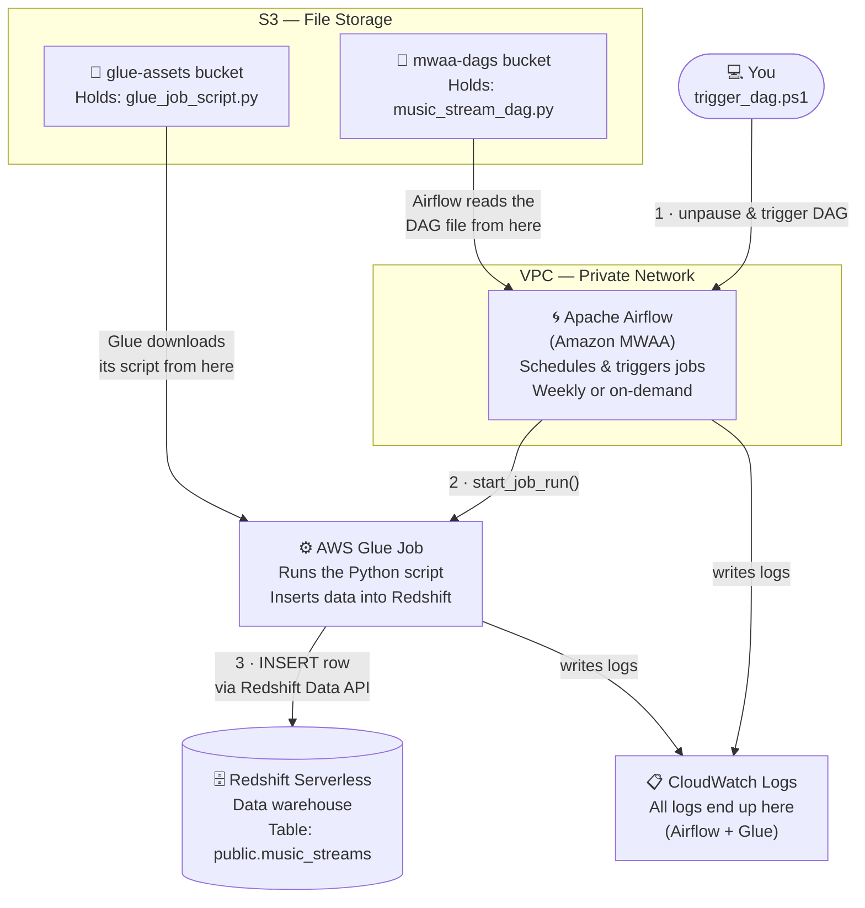
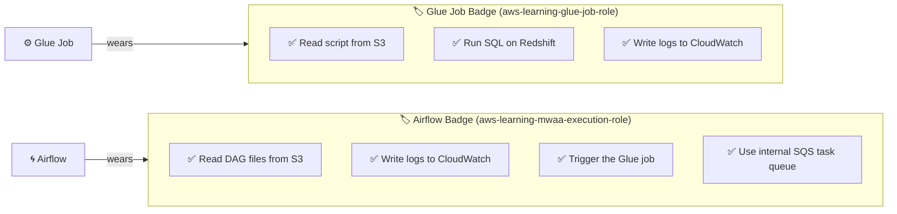
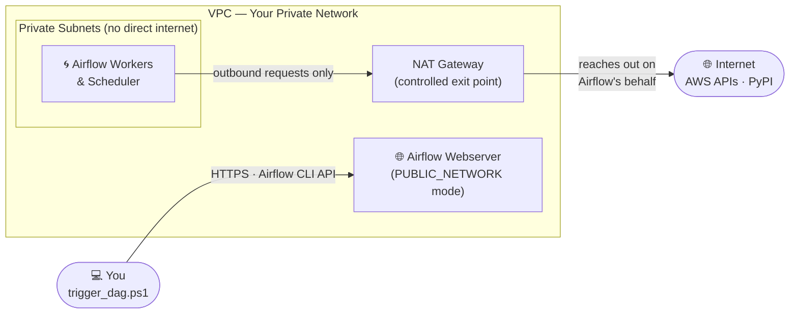

# AWS Learning Architecture — Diagrams

---

## Overview: What Lives in AWS and How It Connects

---

## IAM: What Runs as What

> IAM roles are like **badges**. Each AWS service wears a badge that lists what it's allowed to do.
> Without the badge, the service can't talk to anything else.

---

## Network: Why There's a VPC

> Airflow (MWAA) is required by AWS to run inside a private network. Its **workers and scheduler**
> always live in private subnets and reach the internet via a NAT Gateway.
>
> The **webserver** is configured with `webserver_access_mode = "PUBLIC_NETWORK"`, which puts a
> public-facing load balancer in front of the Airflow UI/API — allowing `trigger_dag.ps1` to
> call the Airflow CLI endpoint from your laptop without VPN access.

